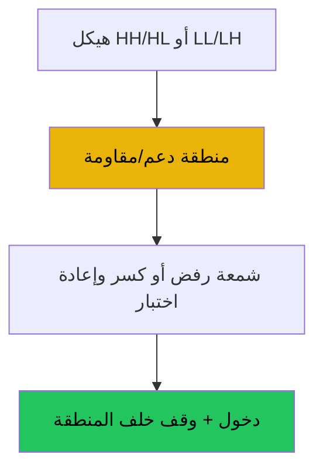

# المستويات والحركة السعرية — عرض بصري كامل

> AI: [`../ai/01-levels.json.md`](../ai/01-levels.json.md) · أمثلة: [`../EXAMPLES_MULTI.md`](../EXAMPLES_MULTI.md)

 

---

## لماذا هذه المدرسة أساس؟

السعر يتفاعل عند **مناطق** سبق احترامها. الشمعة وحدها في الفراغ ضوضاء؛ الشمعة **عند المنطقة** حدث.



---

## الهيكل بصرياً

```text
صاعد:          هابط:
    HH              LH
   /  \            /  \
  /    HL        LL    \
 HH0                    LL0
```

| إشارة هيكل | معنى للمتداول |
|------------|----------------|
| HH + HL | انحياز شراء على التراجعات |
| LL + LH | انحياز بيع على التصحيحات |
| كسر HL لتحت | تحذير — لا تفترض استمرار الصعود |

---

## أربعة سيتبات — بطاقات

### 1) ارتداد مع الترند (Long)

```text
  HH
 /  \
/    \___  ← منطقة طلب ██
         ↑ دخول بعد Pin
```

خطوات: ترند سليم → السعر في المنطقة → Pin/Engulfing → فوق الشمعة → وقف تحت المنطقة → أهداف القمة / 1.5R.

### 2) ارتداد مع الترند (Short) — مرآة عند العرض.

### 3) كسر وإعادة اختبار (Long)

```text
كسر فوق ─── ثم رجوع للخط ─── رفض صاعد ─── متابعة
         المستوى كان مقاومة → صار دعم
```

### 4) فشل كسر (Short)

خروج فوق المقاومة ثم إغلاق تحتها خلال K شموع → وقف فوق القمة الكاذبة.

---

## ألوان العرض

| عنصر | لون |
|------|-----|
| منطقة طلب | أخضر شفاف |
| منطقة عرض | أحمر شفاف |
| شمعة إشارة | تمييز ساطع |
| خط إبطال | برتقالي |

## في المشروع

كواشف: `level`, `ohl_break` · طبقة Location + Trigger · راجع [INDICATOR_MAP](../INDICATOR_MAP.md).
