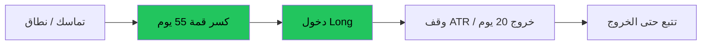

# تتبع الاتجاه — عرض بصري

> AI: [`../ai/02-trend.json.md`](../ai/02-trend.json.md)

 

---

## فكرة بسرعة

نشتري القوة بعد كسر واضح ونبيع الضعف بعد كسر هابط — **نتحمّل خسارة صغيرة متكررة** مقابل صفقات نادرة كبيرة.



```text
السعر
  |          /*\\  فائز كبير
  |        /*
  |  ----/*  كسر
  | /*\/     إشارات كاذبة في النطاق
  +---------------- زمن
```

---

## صعودي | هبوطي

| | صعودي Turtle-style | هبوطي |
|--|-------------------|--------|
| شرط | إغلاق فوق أعلى 55 | إغلاق تحت أدنى 55 |
| وقف | ~2×ATR أو تحت قاع 20 | ~2×ATR أو فوق قمة 20 |
| هدف | تتبّع — بدون هدف ثابت إجباري | نفس المنطق |
| مزاج | صبر + حجم من التقلب | صبر |

### بطاقة تحذير
> في السوق العرضي النظام «يتألم». فلتر نظام (ADX/نطاق) اختياري — أو اقبل الخسارة كجزء من الحافة.

---

## في الرادار
يمكن أن يغذّي طبقة **HTF / Regime** وPrimary على اليومي. ليس سكالب 1m.
