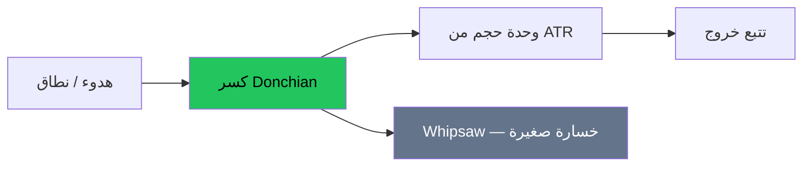

# تتبع الاتجاه — عرض بصري كامل

> AI: [`../ai/02-trend.json.md`](../ai/02-trend.json.md)


---

## الشكل الذهني

خسارة صغيرة متكررة + صفقات نادرة كبيرة = شكل الترند. من يطلب نسبة فوز 80% هنا في المدرسة الغلط.



```text
حقوق:     /*\\/*\\    فائز
        /*
إشارات: /\/\/\     خسائر صغيرة
```

---

## الأنظمة المعروضة

| نظام | دخول | خروج شائع | مزاج |
|------|------|-----------|------|
| Turtle 55 | إغلاق خارج أعلى/أدنى 55 | قناة أقصر / ATR | أقل ضجيج |
| Turtle 20 | 20 يوم | أسرع | أكثر صفقات |
| SMA 10/40 | تقاطع/تكدس | تقاطع عكسي | أنعم |

### Long 55 — بطاقة

1. فريم يومي  
2. إغلاق > أعلى 55  
3. حجم = f(ATR)  
4. وقف ~2×ATR  
5. لا هدف ثابت إجباري — تتبّع  

### Short 55 — نفس الخطوات مقلوبة  
**تنبيه:** على أصول صاعدة هيكلياً طويل الأمد، اختبر long-only قبل ما تعتمد الشورت.

---

## تأثيرات واجهة مقترحة

- تظليل قناة Donchian  
- وميض عند كسر الإغلاق  
- شريط «وحدات» ATR  

## في المشروع

`turtle55`, `sma1040` · طبقة Regime/HTF · بحث **R1** تكاليف.
