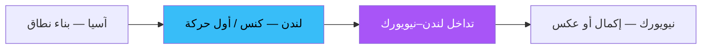

# السيولة والجلسات — عرض بصري

> AI: [`../ai/03-sessions.json.md`](../ai/03-sessions.json.md)


---

## سلسلة اليوم



```text
آسيا:     [======== نطاق ========]
لندن:        \كنس القاع/  ثم صعود
             ×  ← وقف تحت الكنس
```

---

## سيتب الكنس

| | صعودي | هبوطي |
|--|--------|--------|
| حدث | كنس قاع آسيا ثم إغلاق فوقه | كنس قمة آسيا ثم إغلاق تحته |
| دخول | بعد الاستعادة أو BOS مصغّر | مرآة |
| وقف | تحت طرف الكنس | فوق طرف الكنس |
| هدف | قمة آسيا / سيولة أعلى | قاع آسيا |

### تأثير عرض
- تظليل نطاق آسيا  
- وميض عند كسر القاع/القمة  
- شارة جلسة حالية على شريط التوقيت

---

## في الرادار
طبقة **Timing** — تُجمع AND مع إعداد آخر؛ الجلسة وحدها ليست صفقة.
