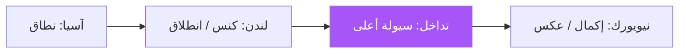

# الجلسات والسيولة — عرض بصري كامل

> AI: [`../ai/03-sessions.json.md`](../ai/03-sessions.json.md)


---

## خريطة اليوم



| نافذة (تقريب NY) | دور بصري |
|------------------|----------|
| آسيا | رسم High/Low فقط — نادراً دخول أكاديمي |
| لندن | ابحث الكنس والاستعادة |
| تداخل | أقوى متابعة |
| بعد الظهر NY | حذر إرهاق الحركة |

---

## سيتب الكنس — قصة مصوّرة

```text
آسيا:  Low ━━━━━━━━━ High
لندن:       ↓ كنس تحت Low
            × ثم إغلاق فوق Low ← دخول Long
            وقف تحت ×
            هدف: High آسيا / سيولة أعلى
```

**هبوطي:** كنس الـ High ثم إغلاق تحته.

### قاعدة ذهبية على الشاشة

> شارة الجلسة **خضراء** = مسموح زمنياً · **رمادية** = خارج النافذة — لا تمنع إعداداً قوياً من HTF إلا بسياسة صريحة.

## في المشروع

`liqline` · طبقة Timing · بحث **R4** · لا صفقة من الساعة وحدها.
