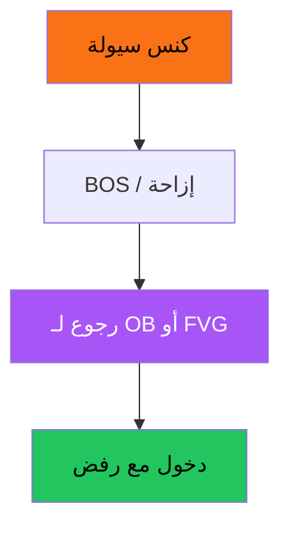

# SMC / ICT — عرض بصري

> AI: [`../ai/04-smc.json.md`](../ai/04-smc.json.md)

 

---

## تسلسل الفكرة



```text
صعودي في الخصم:
  سيولة سفلية × كنس
         \
          \→ BOS لأعلى
              رجوع لمنطقة طلب ██
                    دخول ↑
```

---

## صعودي | هبوطي

| خطوة | صعودي | هبوطي |
|------|--------|--------|
| الموقع | Discount | Premium |
| الكنس | أسفل | أعلى |
| المنطقة | OB/FVG طلب | OB/FVG عرض |
| الوقف | تحت المنطقة والكنس | فوقها |
| الهدف | سيولة علوية | سيولة سفلية |

### تنبيه بصري
كل مستطيل «OB» بدون قاعدة كود ثابتة = ضجيج. الأكاديمية تعرض الفكرة؛ الـ Lab لا يقبل إلا تعريف ثابت.

---

## في الرادار
Context / Location — لا Grade من SMC وحده.
