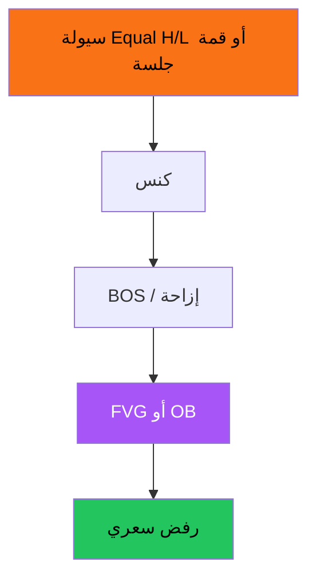

# SMC / ICT — عرض بصري كامل

> AI: [`../ai/04-smc.json.md`](../ai/04-smc.json.md) · أدلة: [`../BACKTEST_EVIDENCE.md`](../BACKTEST_EVIDENCE.md)

 

---

## السلسلة التي نعلّمها (لا نضمن الربح)



## Premium / Discount

```text
قمة النطاق ──── Premium (تفضيل بيع)
        EQ ──── الوسط
قاع النطاق ──── Discount (تفضيل شراء)
```

## بطاقات

| اسم | Long | Short |
|-----|------|-------|
| Sweep + FVG | كنس تحت + رجوع لفجوة صاعدة | كنس فوق + فجوة هابطة |
| Sweep + OB | طلب بعد إزاحة | عرض بعد إزاحة |
| OTE | ارتداد 62–79% بعد BOS صاعد | مرآة |

### صندوق صدق

الاختبارات الميكانيكية العامة غالباً **edge صغير** بعد التكاليف — ليست السردية على يوتيوب. في المشروع: Context حتى يثبت **R5**.

## في المشروع

يحتاج تعريفات كود ثابتة قبل Lab · لا ترفع Grade من SMC وحده.
