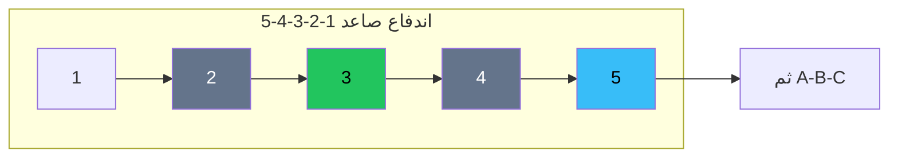

# إليوت — النسخة البصرية

> للعرض في الأكاديمية. التنفيذ والقواعد الصارمة: [`../ai/05-elliott.json.md`](../ai/05-elliott.json.md)

 

---

## صورة الموجة الدافعة



```text
 السعر
   ^
   |           3
   |          /\
   |         /  \
   |     1  /    \ 5
   |    /\ /      \/
   |   /  2        
   |  /
   +-----------------> زمن
        ^إبطال: تحت بداية 1
```

---

## القواعد الثلاث — بطاقات

| # | القاعدة | لو انكسرت |
|---|--------|-----------|
| 1 | الموجة 2 لا تتجاوز بداية 1 | العدّ مات |
| 2 | الموجة 3 ليست الأقصر بين 1-3-5 | العدّ مات |
| 3 | الموجة 4 لا تدخل منطقة 1 (اندفاع عادي) | العدّ مات |

---

## سيتب موجة 3 — صعودي vs هبوطي

<table>
<tr>
<td width="50%">

### صعودي
```text
        3?
       /
   1  /
  /\/ 2
 /  \/
100  104
 └إبطال
```

1. **سياق:** يومي صاعد  
2. **شرط:** 2 فوق 100  
3. **دخول:** كسر مصغّر أو حد ~105  
4. **وقف:** تحت 100  
5. **هدف:** امتداد 1.0–1.618  

</td>
<td width="50%">

### هبوطي
```text
110
 \  2
  \/\
   1  \
       \ 3?
```

1. **سياق:** يومي هابط  
2. **شرط:** 2 تحت 110  
3. **دخول:** كسر مصغّر هابط  
4. **وقف:** فوق 110  
5. **هدف:** امتداد هابط  

</td>
</tr>
</table>

### صندوق الإبطال
> كسر **بداية الموجة 1** بإغلاق = خروج فوري. تتداول الإبطال لا الاقتناع بالعدّ.

---

## في الرادار

طبقة **Context** فقط — لا ترفع Grade وحدها. الصوت يمكنه يقول: «عدّ بديل؛ الإبطال عند …».
