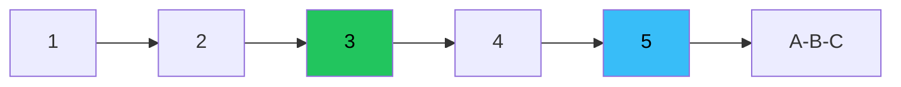

# إليوت — عرض بصري كامل

> AI: [`../ai/05-elliott.json.md`](../ai/05-elliott.json.md)


---

## الاندفاع



```text
        3
       /\
   1  /  \
  /\/    \5
 /  2
^إبطال تحت بداية 1
```

## القواعد الثلاث — لافتات حمراء

1. 2 لا تتجاوز بداية 1  
2. 3 ليست الأقصر  
3. 4 لا تتداخل مع 1 (اندفاع عادي)  

## سيتبات

| | Long موجة 3 | Short موجة 3 |
|--|-------------|--------------|
| بعد | تصحيح 2 صاعد | تصحيح 2 هابط |
| وقف | تحت بداية 1 | فوق بداية 1 |
| الفكرة | تتداول **الإبطال** | نفس المبدأ |

## في المشروع

ZigZag / OTE · Context · لا Grade وحدها · Lab غير مثبت كـ primary.
