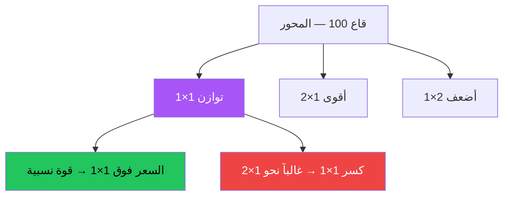

# جان (Gann) — النسخة البصرية

> مرجع AI: [`../ai/06-gann.json.md`](../ai/06-gann.json.md)

 

---

## مروحة الزوايا من قاع



```text
        2×1
       /
      /  سعر
     / 1×1  ← ارتداد صعودي هنا
    /
   /
 100··············→ زمن
```

---

## سيتب 1×1

| | صعودي | هبوطي |
|--|--------|--------|
| المحور | قاع مهم | قمة مهمة |
| الحدث | لمس 1×1 من فوق + رفض صاعد | لمس 1×1 من تحت + رفض هابط |
| دخول | فوق شمعة الرفض | تحت شمعة الرفض |
| وقف | تحت القاع / تحت 1×1 | فوق القمة / فوق 1×1 |
| هدف | 2×1 أو قمة سابقة | 1×2 أو قاع سابق |

### تأثير عرض مقترح
- خط 1×1 بنفسجي نابض عند اقتراب السعر  
- عند الرفض: وميض أخضر/أحمر على الشمعة  
- زر «كسر الزاوية» يعرض سيناريو المتابعة للزاوية التالية

---

## في الرادار
Context بصري. لا Grade من جان وحده.
