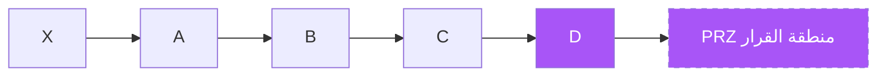

# التوافقي — النسخة البصرية

> مرجع AI: [`../ai/07-harmonic.json.md`](../ai/07-harmonic.json.md)

 

---

## هيكل XABCD



```text
صعودي (D قاع):
X
 \    B
  \  / \
   A/   \
         C
          \
           D ← PRZ شراء

هبوطي (D قمة): مرآة عمودية
```

---

## جدول الأنماط — لون واحد لكل نمط

| نمط | لون بطاقة | B/XA | D/XA | D ضد X |
|-----|-----------|------|------|--------|
| Gartley | أخضر داكن | 0.618 | 0.786 | داخل |
| Bat | سماوي | 0.38–0.50 | 0.886 | داخل |
| Butterfly | برتقالي | 0.786 | 1.272 | **بعد** |
| Crab | أحمر داكن | 0.38–0.62 | 1.618 | **بعد** |

---

## سيتب Gartley — عمودان

**صعودي:** X=100 → A=80 → B≈92 → D≈84  
دخول عند رفض D · وقف تحت 100 · أهداف 38.2% ثم 61.8% من AD

**هبوطي:** نفس النسب مقلوبة · وقف فوق X

### تأثيرات عرض
- تظليل PRZ بنفسجي شفاف  
- تسلسل رسم النقاط X→A→B→C→D بتأخير  
- تبديل النمط من قائمة يغيّر النسب على الرسم  
- تحذير: «النسبة اكتملت ≠ ادخل» حتى يظهر الرفض

---

## في الرادار
Context عند PRZ. Lab لاحقاً لكل `harmonic_*` على حدة.
