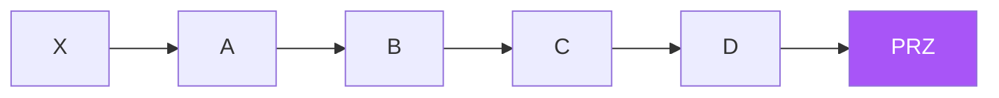

# التوافقي — عرض بصري كامل

> AI: [`../ai/07-harmonic.json.md`](../ai/07-harmonic.json.md)

---

## XABCD

| نمط | لون بطاقة | D |
|-----|-----------|---|
| Gartley | أخضر | 0.786 داخل X |
| Bat | سماوي | 0.886 داخل X |
| Butterfly | برتقالي | 1.272 بعد X |
| Crab | أحمر | 1.618 بعد X |

**النسبة اكتملت ≠ ادخل** — انتظر رفضاً في PRZ.

## في المشروع

`harmonic_*` منفصل لكل نمط · ε · لا تجميع إحصائي أعمى.
