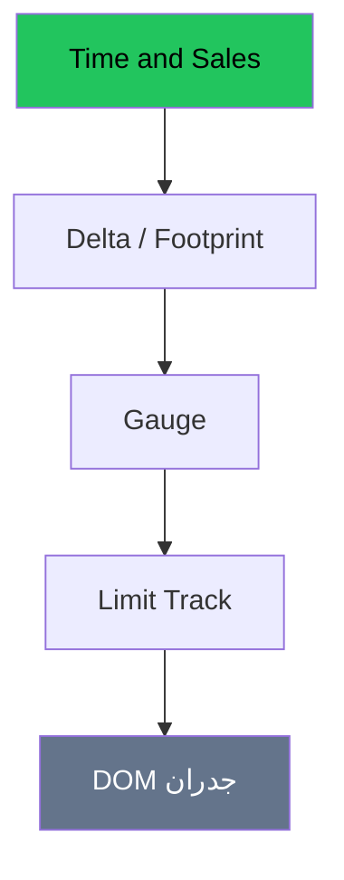

# تدفق الأوامر — عرض بصري كامل

> AI: [`../ai/08-orderflow.json.md`](../ai/08-orderflow.json.md)


---

## هرم الثقة (احفظه)



| أداة | سؤال يجاوب عليه | خدع شائعة |
|------|-----------------|-----------|
| Tape | مين نفذ؟ | تجاهل الحجم النسبي |
| Delta | مين المعتدي؟ | إشارة بلا مستوى |
| Gauge | الزخم القصير؟ | ضجيج ثانيتين |
| Limit Track | اتسحب ولا اتملّا؟ | PLACED = دعم |
| DOM | فين الراحة الآن؟ | جدران وهمية |

---

## مشهد امتصاص Long

```text
مستوى دعم ████████
Tape: بيع بيع بيع ... السعر ثابت
Delta: سالب كبير → يتحول +
        ★ بوابة تُفتح للدخول من إعداد الأب
```

## سياسة الأكاديمية على الشاشة

شارة OF: **رمادي** = لا مستوى أب · **أخضر/أحمر** = بوابة مع اتجاه المستوى فقط.

## في المشروع

`dom_panel`, absorption, gauge · طبقة OF · بحث **R6** journal.
