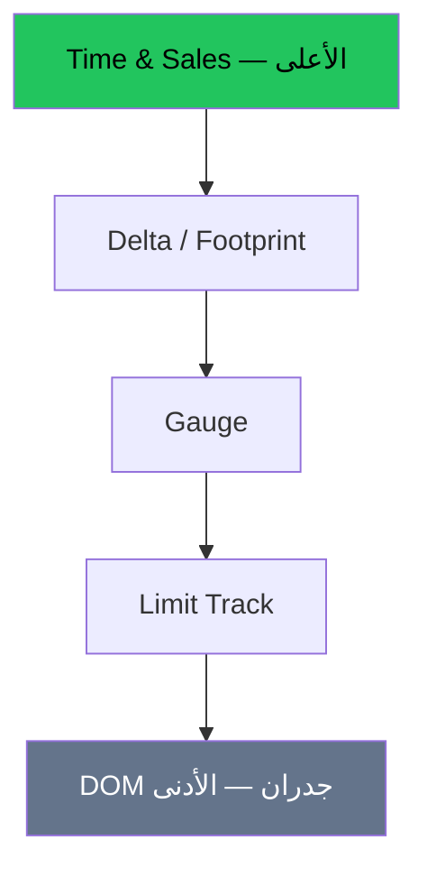

# تدفق الأوامر — عرض بصري

> AI: [`../ai/08-orderflow.json.md`](../ai/08-orderflow.json.md)


---

## هرم الموثوقية



---

## سيتب عند مستوى جاهز

| | صعودي | هبوطي |
|--|--------|--------|
| قبل | مستوى طلب من الشارت | مستوى عرض |
| ماذا ترى | بيع يُمتص والسعر لا يكسر | شراء يُمتص |
| دخول | مع تحول الدلتا / ثبات المستوى | مرآة |
| وقف | تحت المستوى | فوق المستوى |

```text
المستوى ████
Tape: بيع... بيع... ثم شراء قوي
Delta: ----→ ++
        دخول
```

### تأثيرات
- شريط Gauge يلوّن أخضر/أحمر  
- تنبيه «امتصاص» عند المستوى فقط  
- لا يدخل الرادار صفقة OF بدون مستوى أب

---

## في الرادار
طبقة **OF / Execution gate** بعد Location وTrigger.
