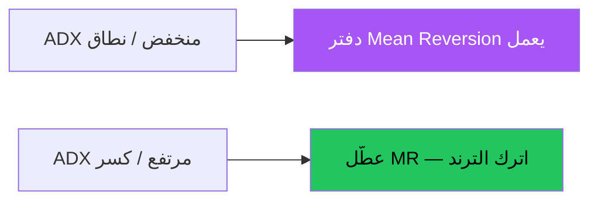

# العودة للمتوسط — عرض بصري كامل

> AI: [`../ai/09-meanrev.json.md`](../ai/09-meanrev.json.md)


---

## مفتاح الفهم



لو شغّلت MR وقت اندفاع قوي = تشتري سكين هابطة أو تبيع صاروخ.

```text
──── قمة النطاق ── بيع استنفاد
         وسط / VWAP
──── قاع النطاق ── شراء استنفاد
```

## بطاقات

| | Long | Short |
|--|------|-------|
| شرط | نطاق + قاع + تشبع | نطاق + قمة + تشبع |
| دخول | عودة داخل النطاق | عودة داخل |
| وقف | خارج الطرف | خارج الطرف |
| هدف | الوسط ثم الطرف الآخر | الوسط |

## في المشروع

نظام منفصل عن Grade الترند · بحث **R3** ثم محفظة **R10**.
