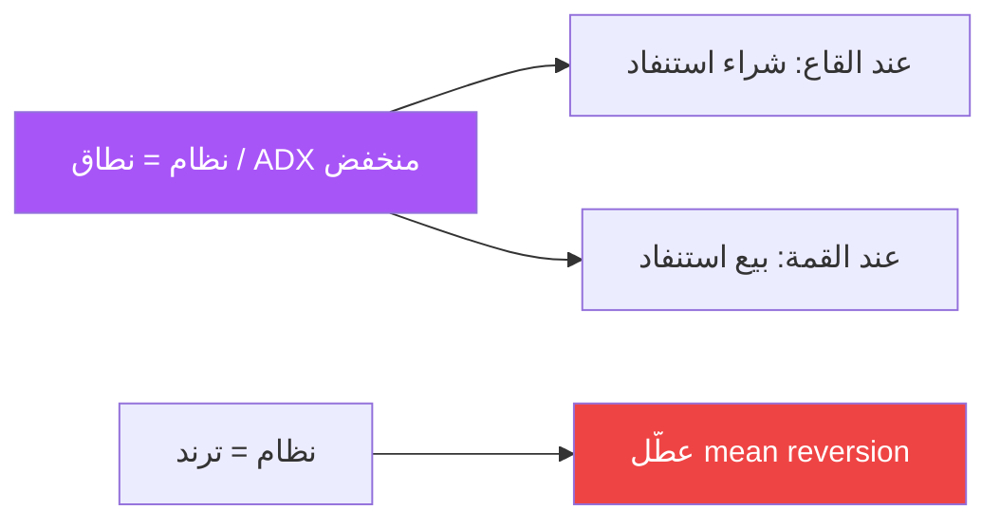

# العودة للمتوسط — عرض بصري

> AI: [`../ai/09-meanrev.json.md`](../ai/09-meanrev.json.md)

 

---

## متى يعمل



```text
قمة النطاق ─────────── بيع استنفاد
        │    وسط / VWAP
قاع النطاق ─────────── شراء استنفاد
```

---

## سيتب

| | صعودي | هبوطي |
|--|--------|--------|
| شرط | نطاق + عند القاع + تشبع | عند القمة + تشبع |
| دخول | شمعة عودة داخل النطاق | مرآة |
| وقف | خارج القاع | خارج القمة |
| هدف | الوسط ثم الطرف الآخر | الوسط |

### بطاقة سياسة
> كتاب mean reversion **منفصل** عن كتاب الترند. لا تدمج الإشارات في Grade واحد بدون سياسة محفظة.

---

## في الرادار
إما بروفيل «Range» منفصل أو إيقاف تام عند Regime=Trend.
