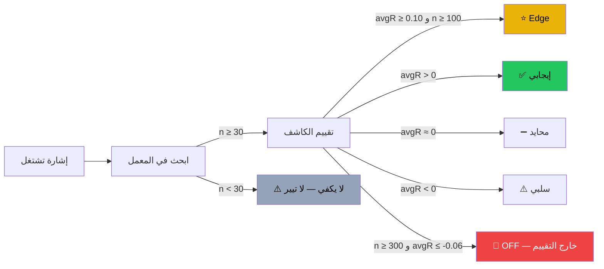

# مختبر التحقق من الكاشفات — عرض بصري

> AI: [`../ai/10-validation-lab.json.md`](../ai/10-validation-lab.json.md)

 

---

## ما هو مختبر التحقق؟

قبل ما تدخل صفقة، اسأل: **هل هذا الكاشف أثبت نفسه في البيانات الحقيقية؟**

مختبر التحقق يجيب على هذا السؤال بأرقام من آلاف الصفقات المسجّلة.



---

## التيرات (Tiers)

| الأيقونة | التيير | الشرط |
|----------|--------|--------|
| ⭐ | Edge | avgR ≥ 0.10 و n ≥ 100 |
| ✅ | إيجابي | avgR > 0 و n ≥ 30 |
| ➖ | محايد | avgR ≈ 0 |
| ⚠️ | سلبي | avgR < 0 |
| 🚫 | OFF | n ≥ 300 و avgR ≤ -0.06 |
| 🔘 | ضعيف | n < 30 — لا دليل |

---

## الإطار الزمني (TF Mapping)

الكاشف قد يكون إيجابياً في الـ 1h وسلبياً في الـ 15m.  
المعمل يستخدم تعيين ثابت:

```
13m → 15m    2h → 1h    3h → 4h    12h → 1d
```

لو ما فيش صف للإطار المُعيَّن، يرجع للـ `all` TF.  
لو n < 30 في الاثنين → **لا دليل (None)**.

---

## إشارات OFF

- إشارات OFF **لا تحذف** من الشارت — تظهر كمعلومة.
- **لا تُضاف** لحساب النجوم والاتجاه.
- تُحسب من ملف المعمل تلقائياً — لا شيء مشفّر يدوياً.

---

## كيف تستخدم التبويب

```text
Stats → Validation Lab
  ↳ فلتر المدرسة (School)
  ↳ فلتر الإطار الزمني
  ↳ الجدول: key · TF · n · avgR · tier
  ↳ الصفوف المُعتمة: n < 30 (لا دليل كافٍ)
```

---

> ⚠️ **تنبيه أمانة:** أرقام المعمل داخل العينة (IS).  
> الأداء المستقبلي قد يختلف. n < 30 ليس دليلاً.  
> القرار النهائي دائماً للمتداول. لا نصيحة استثمارية.
