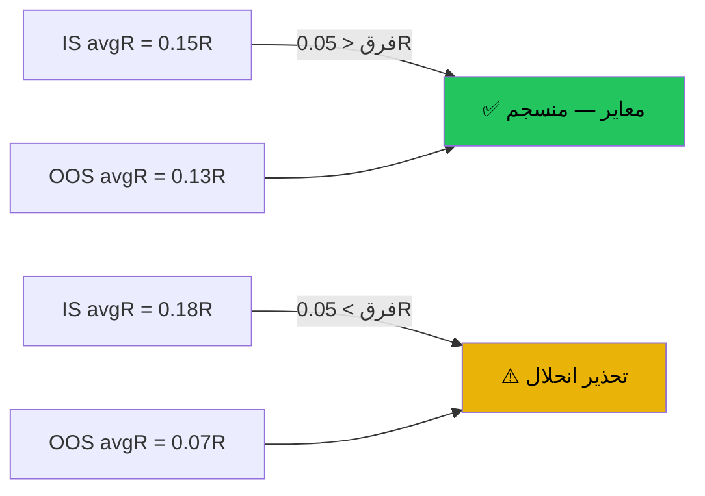

# معايرة الانحلال — IS vs OOS — عرض بصري

> AI: [`../ai/11-calibration.json.md`](../ai/11-calibration.json.md)

 

---

## السؤال الأساسي

> **هل الإشارة تعمل على بيانات جديدة، أم فقط على البيانات اللي اتدرّبت عليها؟**

هذا هو الفرق بين **IS** و**OOS**.

---

## IS vs OOS بالبساطة

```text
بيانات كاملة
├── IS (in-sample)  → الكاشف اتعلّم منها → أداء مرتفع دائماً
└── OOS (out-of-sample) → بيانات ما شافهاش الكاشف → الاختبار الحقيقي
```



---

## مقياس الفجوة

| الفجوة (IS − OOS) | الحكم |
|-------------------|-------|
| ≤ 0.05R | ✅ معاير — استخدم IS كتوقع |
| 0.05 → 0.20R | ⚠️ احتياط — استخدم OOS كتوقع |
| > 0.20R | 🚫 علامة حمراء — راجع الكاشف |
| لا OOS | — لا يمكن التقييم |

---

## جدول الأداء حسب الإطار الزمني

التبويب يعرض صفوف المعمل مرتّبة من أعلى avgR لأقل:

```text
key        TF    n     IS avgR   OOS avgR   فجوة   حالة
rsi_div    1h    142   +0.120    +0.091     0.029   ✅
rsi_div    15m   87    +0.098    +0.034     0.064   ⚠️
rsi_div    4h    31    +0.071    —          —       (لا OOS)
```

الصفوف بـ n < 30 تظهر خافتة — لا تقييم.

---

## قيود المعمل

> ⚠️ **قيد مهم:** ملف المعمل لا يحتوي تواريخ صفقات.  
> لذلك لا يمكن رسم منحنى انحلال حقيقي عبر الزمن.  
> IS vs OOS هو التقريب المتاح — وهو نافع لكنه ليس اختبار الزمن الكامل.

---

> القرار النهائي دائماً للمتداول. لا نصيحة استثمارية.
