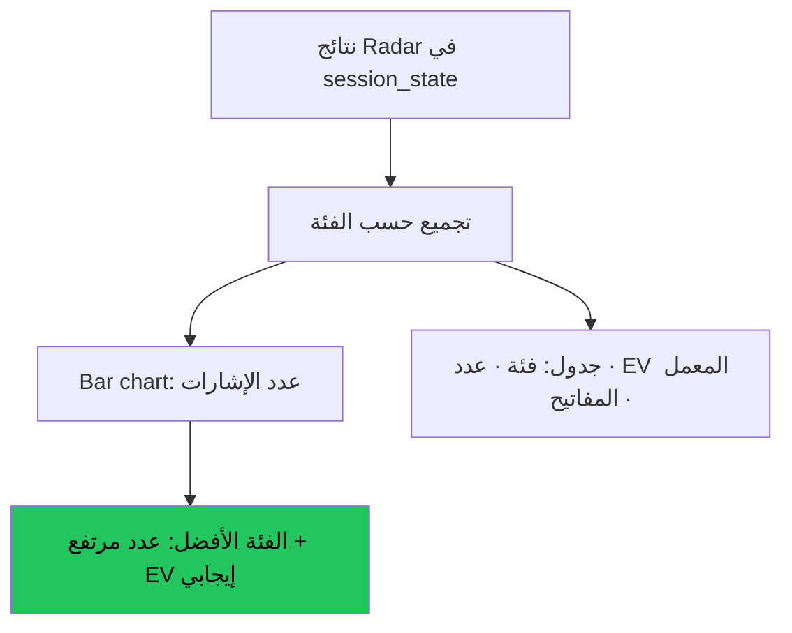

# الماسح والتدوير بين فئات الأصول — عرض بصري

> AI: [`../ai/12-rotation.json.md`](../ai/12-rotation.json.md)

 

---

## الفكرة الأساسية

> **مش كل الأصول بتتحرك في نفس الوقت.**  
> تبويب التدوير يسألك: "أي فئة أصول فيها أكثر إشارات مدعومة بالمعمل الآن؟"

---

## تصنيف الأصول

الأداة تصنّف كل رمز تلقائياً:

| البادئة / النمط | الفئة |
|-----------------|-------|
| `HL:xau` | Metals (ذهب وفضة) |
| `HL:spx`, `HL:ndx` | Indices |
| `HL:oil`, `HL:gas` | Oil & Gas |
| `FH:EUR...` وغيرها | Forex |
| `Y:AAPL` وغيرها | Stocks |
| باقي `HL:` | Indices/Metals حسب الرمز |
| الباقي | Crypto |

---

## كيف يعمل التبويب



> ⚠️ **مهم:** تبويب التدوير **لا يشغّل مسح جديد**.  
> يقرأ فقط نتائج Radar المحفوظة في الجلسة.  
> لو ما في نتائج → ابدأ من صفحة Radar أولاً.

---

## قراءة نتائج التدوير

```text
Crypto       ████████ 8 إشارات   EV = +0.082R  ✅
Indices      ████ 4              EV = +0.031R  ✅
Metals       ██ 2                EV = +0.061R  ✅
Forex        █ 1                 EV = -0.024R  ⚠️
Stocks       ░ 0                 —
```

**افهم الجدول صح:**
- **عدد كبير + EV إيجابي** = فئة تستحق الاهتمام
- **عدد كبير + EV سلبي** = إشارات كثيرة لكن المعمل يقول تجنّبها
- **إشارة واحدة + EV مرتفع** قد تكون أفضل من 5 إشارات محايدة

---

> القرار النهائي دائماً للمتداول. لا نصيحة استثمارية.
