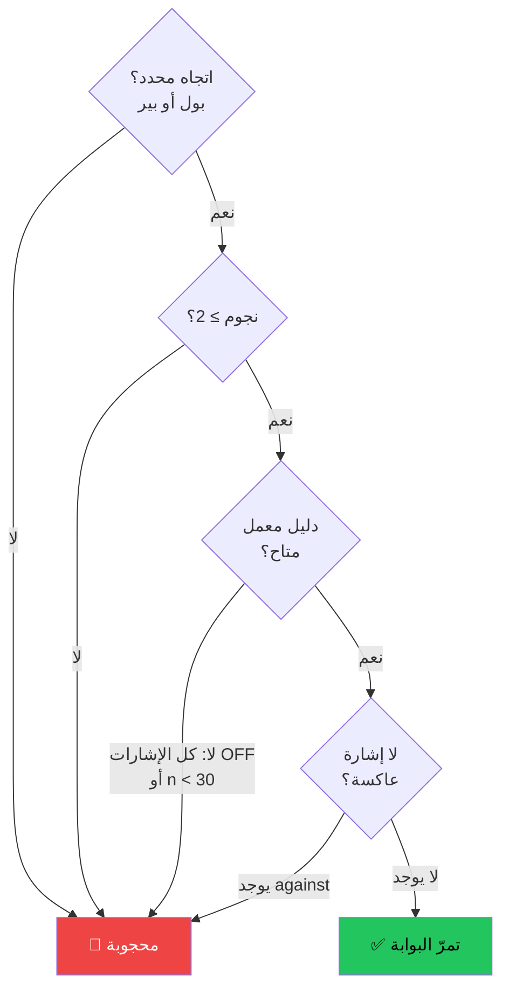

# بوابة القرار — مكتب القرار — عرض بصري

> AI: [`../ai/13-decision-gate.json.md`](../ai/13-decision-gate.json.md)

 

---

## الفكرة الأساسية

> **قبل أي دخول، اسأل أربعة أسئلة.**  
> كل إجابة "لا" تحجب البوابة كاملاً.

---

## شروط البوابة (الأربعة معاً)



---

## النجوم ☆ → ★

```text
☆☆☆☆☆  (0)  لا إشارات كافية
★☆☆☆☆  (1)  ضعيف — لا يمرّ البوابة
★★☆☆☆  (2)  الحد الأدنى للمرور
★★★☆☆  (3)  قناعة متوسطة
★★★★☆  (4)  قناعة جيدة
★★★★★  (5)  قناعة قوية
```

---

## الإشارة العاكسة (Against)

| الحالة | الأثر |
|--------|-------|
| `against = False` | لا عقوبة |
| `against = True` | يحجب البوابة + عقوبة 0.10R على دليل المعمل |

**مثال:**  
إشارات صعودية avgR = +0.08R + إشارة عاكسة = +0.08 − 0.10 = **−0.02R** → بوابة محجوبة

---

## إشارات OFF في مكتب القرار

- إشارات OFF **لا تدخل** في النجوم أو الاتجاه
- **تُعرض كتحذير** فقط — المتداول يقرر
- لو **كل** الإشارات OFF → دليل المعمل = None → البوابة محجوبة

---

## تأكيد الإطار الأعلى (HTF)

HTF **ليس شرطاً في البوابة** — لكنه يضيف قناعة:

```text
1h يمرّ البوابة ← 4h يؤكد الاتجاه → قناعة أقوى
1h يمرّ البوابة ← 4h عكس → تحذير، انتبه
```

---

## قراءة مكتب القرار

```text
رمز: BTC-USDT  |  إطار: 1h
الاتجاه: صعود 🟢  |  النجوم: ★★★☆☆
دليل المعمل: +0.082R  |  البوابة: ✅ تمرّ
─────────────────────────────────────
HTF 4h: ✅ يؤكد — RSI Div + Level
السيناريوهات:
  1. كسر أعلى وهدف 1h HH (target 2R)
  2. فشل الكسر — وقف تحت المنطقة
```

---

> ⚠️ **تذكير:** البوابة تعني الحد الأدنى — لا تعني ضمان الربح.  
> الحجم والوقف والإدارة مسؤوليتك أنت.  
> القرار النهائي دائماً للمتداول. لا نصيحة استثمارية.
