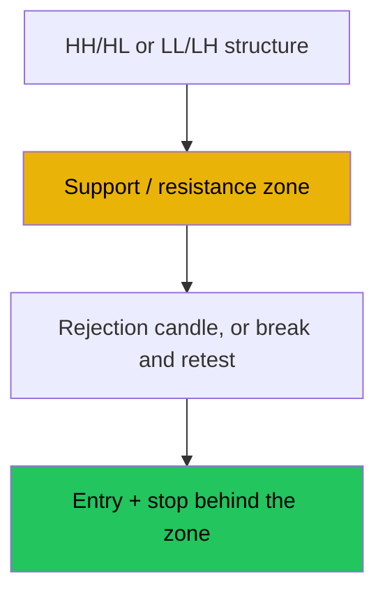

# Levels and Price Action — Full Visual Overview

> AI: [`../ai/01-levels.json.md`](../ai/01-levels.json.md) · Examples: [`../EXAMPLES_MULTI.md`](../EXAMPLES_MULTI.md)

 

---

## Why is this school the foundation?

Price reacts at **zones** that were respected before. A candle alone in a vacuum is noise; a candle **at a zone** is an event.



---

## The structure visually

```text
Up:            Down:
    HH              LH
   /  \            /  \
  /    HL        LL    \
 HH0                    LL0
```

| Structure signal | What it means for the trader |
|------------------|------------------------------|
| HH + HL | A buy bias on pullbacks |
| LL + LH | A sell bias on corrections |
| A break of HL downward | A warning: do not assume the rise continues |

---

## Four setups: cards

### 1) A bounce with the trend (Long)

```text
  HH
 /  \
/    \___  <- demand zone ██
         ^ entry after a Pin
```

Steps: a sound trend, price in the zone, Pin/Engulfing, above the candle, a stop below the zone, targets at the high / 1.5R.

### 2) A bounce with the trend (Short): a mirror at supply.

### 3) Break and retest (Long)

```text
Break above --- then back to the line --- a bullish rejection --- follow-through
         The level was resistance -> became support
```

### 4) Failed breakout (Short)

A move above resistance and then a close below it within K candles, then a stop above the false high.

---

## Display colors

| Element | Color |
|---------|-------|
| Demand zone | Transparent green |
| Supply zone | Transparent red |
| Signal candle | A bright highlight |
| Invalidation line | Orange |

## In the project

Detectors: `level`, `ohl_break` · the Location + Trigger layer · see [INDICATOR_MAP](../INDICATOR_MAP.md).
