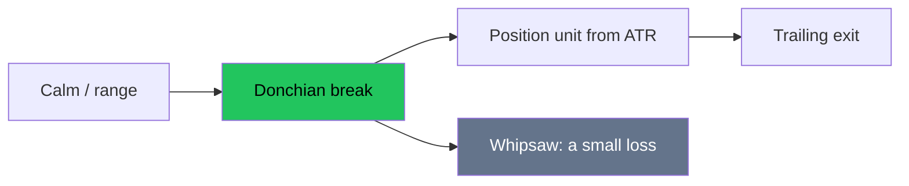

# Trend Following — Full Visual Overview

> AI: [`../ai/02-trend.json.md`](../ai/02-trend.json.md)


---

## The mental picture

Small repeated losses + rare big trades = the shape of trend. Anyone who asks for an 80% win rate here is in the wrong school.



```text
Equity:   /*\\/*\\    winner
        /*
Signals: /\/\/\     small losses
```

---

## The systems shown

| System | Entry | Common exit | Temperament |
|--------|-------|-------------|-------------|
| Turtle 55 | A close outside the 55 high/low | A shorter channel / ATR | Less noise |
| Turtle 20 | 20 days | Faster | More trades |
| SMA 10/40 | Cross / stacking | An opposite cross | Smoother |

### Long 55: card

1. Daily timeframe  
2. Close > the 55 high  
3. Size = f(ATR)  
4. Stop about 2xATR  
5. No mandatory fixed target: trail  

### Short 55: the same steps reversed  
**Warning:** on assets that rise structurally over the long term, test long-only before you adopt the short.

---

## Suggested interface effects

- Shading of the Donchian channel  
- A flash on a close break  
- An ATR "units" bar  

## In the project

`turtle55`, `sma1040` · the Regime/HTF layer · research **R1** costs.
