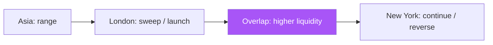

# Sessions and Liquidity — Full Visual Overview

> AI: [`../ai/03-sessions.json.md`](../ai/03-sessions.json.md)


---

## The map of the day



| Window (approx. NY) | Visual role |
|---------------------|-------------|
| Asia | Draw the High/Low only: rarely an academic entry |
| London | Look for the sweep and the reclaim |
| Overlap | The strongest follow-through |
| NY afternoon | Beware of move exhaustion |

---

## The sweep setup: an illustrated story

```text
Asia:  Low ━━━━━━━━━ High
London:       ↓ sweep below Low
            × then a close above Low -> Long entry
            stop below ×
            target: the Asia High / higher liquidity
```

**Bearish:** a sweep of the High and then a close below it.

### A golden rule on screen

> A **green** session badge = allowed by time · **grey** = outside the window: do not block a strong HTF setup except by an explicit policy.

## In the project

`liqline` · the Timing layer · research **R4** · no trade from the hour alone.
