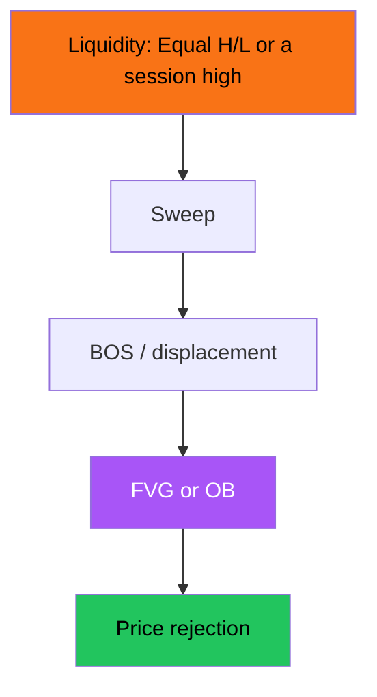

# SMC / ICT — Full Visual Overview

> AI: [`../ai/04-smc.json.md`](../ai/04-smc.json.md) · Evidence: [`../BACKTEST_EVIDENCE.md`](../BACKTEST_EVIDENCE.md)

 

---

## The chain we teach (we do not guarantee profit)



## Premium / Discount

```text
Range high ---- Premium (sell preference)
        EQ ---- The middle
Range low  ---- Discount (buy preference)
```

## Cards

| Name | Long | Short |
|------|------|-------|
| Sweep + FVG | A sweep below + a return to a bullish gap | A sweep above + a bearish gap |
| Sweep + OB | Demand after a displacement | Supply after a displacement |
| OTE | A 62-79% retracement after a bullish BOS | Mirror |

### An honesty box

Generic mechanical tests usually find a **small edge** after costs: not the YouTube narrative. In the project: Context until **R5** proves it.

## In the project

It needs fixed code definitions before the Lab · do not raise the Grade from SMC alone.
