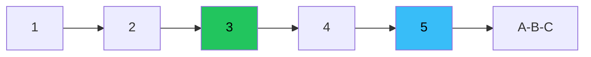

# Elliott — Full Visual Overview

> AI: [`../ai/05-elliott.json.md`](../ai/05-elliott.json.md)


---

## The impulse



```text
        3
       /\
   1  /  \
  /\/    \5
 /  2
^ invalidation below the start of 1
```

## The three rules: red banners

1. 2 does not go beyond the start of 1  
2. 3 is not the shortest  
3. 4 does not overlap 1 (a normal impulse)  

## Setups

| | Long wave 3 | Short wave 3 |
|--|-------------|--------------|
| After | A bullish correction 2 | A bearish correction 2 |
| Stop | Below the start of 1 | Above the start of 1 |
| The idea | You trade the **invalidation** | The same principle |

## In the project

ZigZag / OTE · Context · no Grade on its own · the Lab has not proven it as primary.
