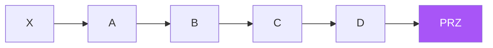

# Harmonic — Full Visual Overview

> AI: [`../ai/07-harmonic.json.md`](../ai/07-harmonic.json.md)

---

## XABCD

| Pattern | Card color | D |
|---------|------------|---|
| Gartley | Green | 0.786 inside X |
| Bat | Sky blue | 0.886 inside X |
| Butterfly | Orange | 1.272 beyond X |
| Crab | Red | 1.618 beyond X |

**The ratio completed is not the same as enter**: wait for a rejection in the PRZ.

## In the project

`harmonic_*` separate for each pattern · epsilon · no blind statistical pooling.
