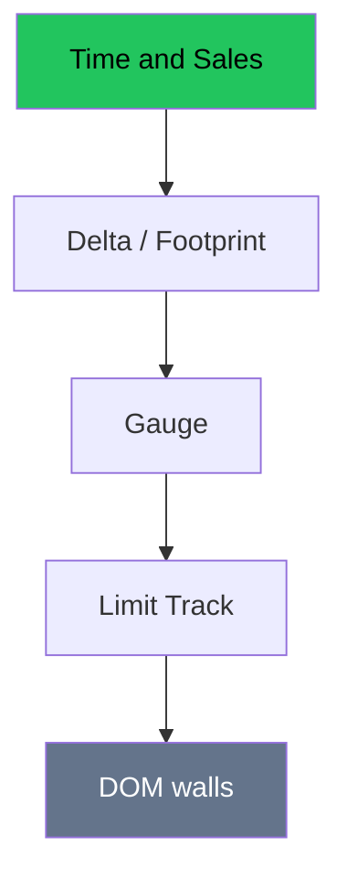

# Order Flow — Full Visual Overview

> AI: [`../ai/08-orderflow.json.md`](../ai/08-orderflow.json.md)


---

## The trust pyramid (memorize it)



| Tool | The question it answers | Common tricks |
|------|-------------------------|---------------|
| Tape | Who executed? | Ignoring relative volume |
| Delta | Who is the aggressor? | A signal with no level |
| Gauge | The short momentum? | Two seconds of noise |
| Limit Track | Pulled or filled? | PLACED = support |
| DOM | Where is the comfort now? | Fake walls |

---

## A Long absorption scene

```text
Support level ████████
Tape: sell sell sell ... price holds
Delta: large negative -> turns +
        ★ the gate opens for entry from the parent setup
```

## The Academy policy on screen

OF badge: **grey** = no parent level · **green/red** = a gate only in the direction of the level.

## In the project

`dom_panel`, absorption, gauge · the OF layer · research **R6** journal.
