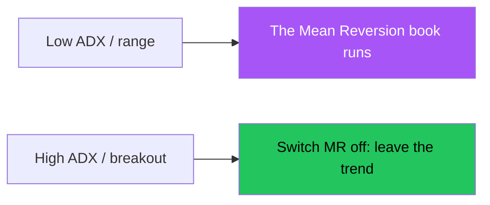

# Mean Reversion — Full Visual Overview

> AI: [`../ai/09-meanrev.json.md`](../ai/09-meanrev.json.md)


---

## The key to understanding



If you run MR during a strong thrust = you are buying a falling knife or selling a rocket.

```text
---- range top -- sell exhaustion
         middle / VWAP
---- range bottom -- buy exhaustion
```

## Cards

| | Long | Short |
|--|------|-------|
| Condition | Range + a low + oversold | Range + a high + overbought |
| Entry | A return inside the range | A return inside |
| Stop | Outside the edge | Outside the edge |
| Target | The middle, then the other edge | The middle |

## In the project

A system separate from the trend Grade · research **R3** then portfolio **R10**.
